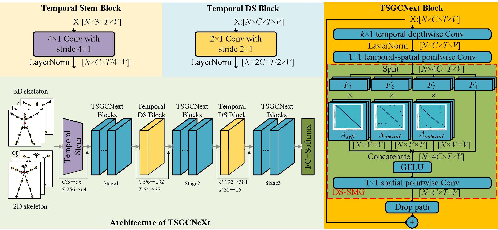
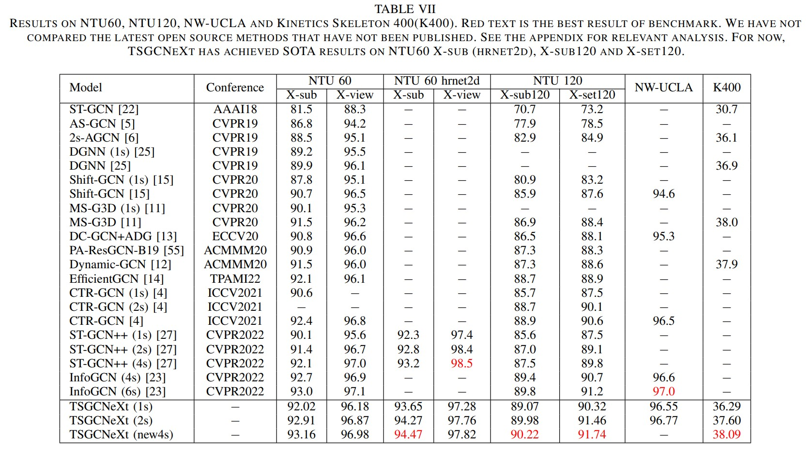
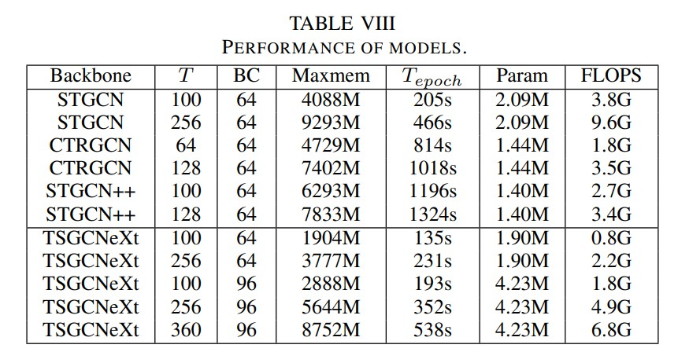

# TSGCNEXT 


## Architecture of TSGCNeXt

# Prerequisites

- Python >= 3.6
- PyTorch >= 1.1.0
- PyYAML, tqdm, tensorboardX

- We provide the dependency file of our experimental environment, you can install all dependencies by creating a new anaconda virtual environment and running `pip install -r requirements.txt `
- Run `pip install -e torchlight` 
- pip install timm==0.3.2 tensorboardX six

# Data Preparation

### Download datasets.

#### There are 3 datasets to download:

- NTU RGB+D 60 Skeleton
- NTU RGB+D 120 Skeleton
- NW-UCLA

#### NTU RGB+D 60 and 120

1. Request dataset here: http://rose1.ntu.edu.sg/Datasets/actionRecognition.asp
2. Download the skeleton-only datasets:
   1. `nturgbd_skeletons_s001_to_s017.zip` (NTU RGB+D 60)
   2. `nturgbd_skeletons_s018_to_s032.zip` (NTU RGB+D 120)
   3. Extract above files to `./data/nturgbd_raw`


### Data Processing

#### Directory Structure

Put downloaded data into the following directory structure:

```
- data/
  - NW-UCLA/
    - all_sqe
      ... # raw data of NW-UCLA
  - ntu/
  - ntu120/
  - nturgbd_raw/
    - nturgb+d_skeletons/     # from `nturgbd_skeletons_s001_to_s017.zip`
      ...
    - nturgb+d_skeletons120/  # from `nturgbd_skeletons_s018_to_s032.zip`
      ...
```

#### Generating Data

- Generate NTU RGB+D 60 or NTU RGB+D 120 dataset:

```
 cd ./data/ntu # or cd ./data/ntu120
 # Get skeleton of each performer
 python get_raw_skes_data.py
 # Remove the bad skeleton 
 python get_raw_denoised_data.py
 # Transform the skeleton to the center of the first frame
 python seq_transformation.py
```
## Training
- Run the following command:

```
CUDA_VISIBLE_DEVICES=0,1 python -m torch.distributed.launch --nproc_per_node=2 main_modern.py --config <work_dir>/config.yaml --batch_size 32 --lr 4e-3 --update_freq 2 --model_ema true --model_ema_eval true --dist_url tcp://127.0.0.3:132
```


## Testing

- To test the trained models saved in <work_dir>, run the following command:

```
python get_info.py --config <work_dir>/config.yaml --work-dir <work_dir> --phase test --save-score True --weights <work_dir>/xxx.pt --device 0
```

- To ensemble the results of different modalities, run 
```
python ensemble.py --dataset ntu120/xset \
--joint-dir work_dir/ntu120/xset252/TSGCNext3_jointmodern \
--bone-dir work_dir/ntu120/xset252/TSGCNext3_bonemodern \
--joint-motion-dir work_dir/ntu120/xset432/TSGCNext3_jointmodern \
--bone-motion-dir work_dir/ntu120/xset432/TSGCNext3_bonemodern \
--ema True
```

### Pretrained Models

- Download pretrained models for producing the final results on NTU RGB+D 60&120 [[Google Drive]](https://drive.google.com/file/d/1FNJUkvGcmEvyqP93SsIV-PnppA4LBdyA/view?usp=share_link).
- Put files to <work_dir> and run **Testing** command to produce the final result.

### Cite
This code is for paper "TSGCNeXt: Dynamic-Static Multi-Graph Convolution for Efficient Skeleton-Based Action Recognition with Long-term Learning Potential".

You can get paper here: https://arxiv.org/abs/2304.11631

New cite is updata: 
```
@article{LIU2025127081,
title = {TSGCNeXt: Dynamic-Static Multi-graph Convolution for efficient skeleton-based action recognition},
journal = {Expert Systems with Applications},
volume = {276},
pages = {127081},
year = {2025},
issn = {0957-4174},
doi = {https://doi.org/10.1016/j.eswa.2025.127081},
url = {https://www.sciencedirect.com/science/article/pii/S0957417425007031},
author = {Dongjingdian Liu and Xiaomeng Li and Zijie Cai and Pengpeng Chen},
keywords = {Activity recognition, Graph convolution neural networks, Dynamic graph convolution, Skeleton-based action recognition, Training acceleration},
abstract = {With the advancement of graph convolutional networks (GCNs), skeleton-based action recognition has made significant progress in human action recognition. Recent methods tend to adopt dynamic graph learning mechanisms, which suffer from sparse graph relations as network depth increases, leading to the loss of joint information. Furthermore, increasingly complex graph learning mechanisms face challenges due to ineffective training caused by non-parallel, combinatorial operations. Meanwhile, skeletal sequences are often downsampled, resulting in the loss of fine-grained details. To address these issues, we propose Temporal-Spatio Graph ConvNeXt (TSGCNeXt), an efficient learning framework designed to preserve fine-grained skeletal sequence information. First, we introduce Dynamic-Static Separate Multi-graph Convolution (DS-SMG), which aggregates features from multiple independent static and dynamic graphs within a parallel topological computational structure. This structure ensures that static branches, which exclude the Laplace operator, prevent joint information from being ignored during dynamic graph learning. Furthermore, we propose a graph convolution training acceleration mechanism that optimizes backpropagation for the parallel topological structure, resulting in a 55.08% speedup in training efficiency. By combining these innovations, TSGCNeXt restructures the overall GCN architecture and integrates spatiotemporal learning modules that efficiently process fine-grained features. Compared to existing methods, TSGCNeXt outperforms single-stream network approaches. Additionally, by incorporating the exponential moving average model into multi-stream fusion, TSGCNeXt achieves state-of-the-art performance. The code is available at https://github.com/vvhj/TSGCNeXt.}
}
```
PS:

如果您有疑问的话也可以加我的微信一起探讨，一起学习！


### 最新进展 

论文投稿限制，最新版论文先不放出了，更新一些实验和分析结果。

### Results



### Performance Analysis


